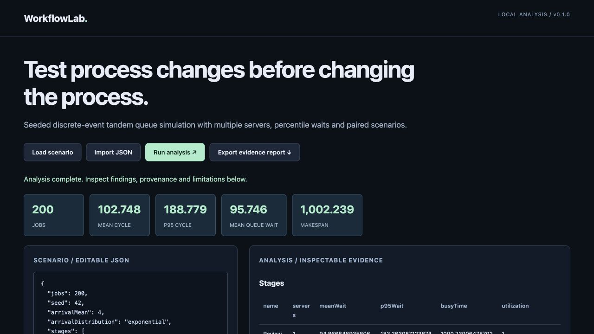

# WorkflowLab

**Test process changes before changing the process.**

Seeded discrete-event tandem queue simulation with multiple servers, percentile waits and paired scenarios.

Original, inspectable Python implementation by mmdev. A scoped research-oriented prototype, not a claim of enterprise maturity, customer adoption or complete standards compliance.

## Quick start

Python 3.11 or newer. No packages, keys or cloud accounts required.

```sh
python3 app.py analyze example.json --output report.json
python3 app.py serve --port 8080
```

Open http://127.0.0.1:8080. Load the included scenario, edit or import JSON, run the analysis, inspect tables and export a report. The workbench only binds to loopback and processes inputs in the local Python process. No external API calls, telemetry, cookies or persistence.

## Tests

```sh
python3 -m unittest discover -v
```

## Architecture

- `engine.py`: deterministic core with `analyze(input)` returning structured evidence.
- `app.py`: CLI plus size-limited, loopback-only JSON workbench server.
- `index.html`: accessible browser interface, evidence tables, metrics and report export.
- `example.json`: synthetic reproducible scenario.
- `test_engine.py`: algorithm invariants, adverse inputs and regression cases.

The engine returns `summary`, domain-specific report sections and explicit `limitations`. It uses no model calls. Input validation is bounded to the supported contract; arbitrary JSON structures are not promised to be meaningful inputs.

## Scope

Read the limitations returned in `report.json`. This version does not connect to live business systems or make external changes. All fixtures are synthetic. Never infer performance or correctness beyond the tested supported cases.

## License

MIT — see LICENSE.

## Design details

See [ARCHITECTURE.md](ARCHITECTURE.md) for the algorithm, guarantees, limitations and roadmap. [example-report.json](example-report.json) is generated from the included fixture.


